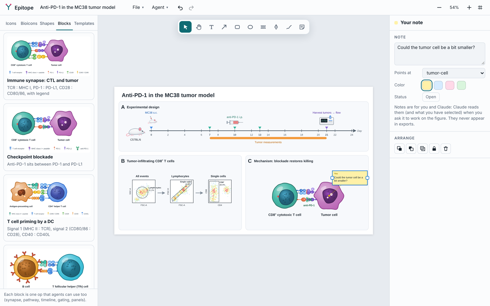

# ForThePlot (4tP)

**Open-source scientific illustration that people and AI agents can both drive.**
A BioRender-style editor with an immunology-first icon library, a plain-JSON figure format,
a command-line tool, and an MCP server, all sharing one rendering engine.



- **Editor.** Drag icons onto a canvas, then move, resize, rotate, recolor, label, group, align and draw arrows that stay attached to cells. Receptors stay seated on their cell when you resize or rotate it. Everything is undoable.
- **Draw your own shapes.** A pen tool (click for corners, drag for curves, edit points afterwards) and a pencil for freehand. Any drawn path can become a phospholipid membrane: a curved plasma membrane, or a cell or organelle of any shape, with receptors that follow the curve.
- **Real data next to the cartoons.** Drop in micrographs, blots and flow plots (PNG, JPEG, TIFF, or SVG, which stays vector). Crop them and add a scale bar from the µm per pixel.
- **GraphPad Prism graphs that stay linked.** Add a graph from a `.prism` file; double-click it to edit in Prism, and when you save there the figure updates. See [Prism graphs](#prism-graphs).
- **Multi-panel figures.** Lettered panels (A, B, C…) as a grid or around existing content. Letters follow reading order and update as panels move; moving a panel moves what is inside it.
- **Gradient fills.** Linear or radial gradients with several colors for shapes, drawn outlines, panels and cell interiors; they stay vector in PDF and SVG.
- **Your own icons.** Select anything you drew and save it as an icon: it goes in the library under Mine for every figure, recolors like any icon, and keeps the credits of any Bioicons inside it.
- **Text sizes in one place.** Set the printed width and see every kind of text (labels, arrow labels, panel titles, letters…) in points. Set a kind across the figure, resize all text in one panel, or give a panel its own letter and title size; agents do the same with one `textSize` op.
- **Building blocks.** One click (or one op) draws a whole motif: an immune synapse whose receptor–ligand pairs actually meet, a signaling pathway laid out in layers across a membrane, an experiment timeline, or a flow cytometry gating strategy. *Tidy* pulls overlapping elements apart.
- **562 original icons, immunology first.** About 185 human cell types across every body system: immune subsets and states (T cell subsets, CAR-T, B and plasma cells, NK, ILCs, macrophages including Kupffer and alveolar, DCs including Langerhans and FDCs, granulocytes, MDSCs), blood and stem cells, skin, gut, liver, pancreas, lung, kidney, neurons and glia, sensory cells, muscle, fat, bone and cartilage, endocrine and reproductive cells, early embryos and mitosis. Antibody formats (IgG to DVD-Ig, BiTE, ADC, immunocytokines), immune receptors and checkpoints, channels and transporters, signaling proteins, ball-and-stick molecules, drug carriers, nucleic acids and gene editing, viruses, bacteria, fungi and parasites, organelles and cell structures, 40 organs and microanatomy views, 24 organisms, 60 pieces of lab equipment and 40 charts and symbols. Drawn in one detailed, shaded style that stays vector in PDF. All recolorable by role and MIT-licensed. The library is grouped (Cells, Proteins & molecules, Microbes, …) with a category dropdown inside each group.
- **2,256 Bioicons built in, recolorable.** The open [Bioicons](https://bioicons.com) library is bundled as a lazy-loaded pack. Tint any of them to one hue or swap single colors. Each icon keeps its license and author.
- **Journal-ready export.** PDF (vector, fonts embedded), TIFF, PNG, SVG and PowerPoint at a physical size: Nature 89/120/136/183 mm or JCI 9–18 cm presets, 300/600/1200 dpi, with a check that every label prints at the journal's minimum text size and a one-click fix. The credit line for your figure legend is written for you.
- **Agents are first-class.** Every edit is a JSON *op* (`add`, `connect`, `attach`, `synapse`, `pathway`…). Agents use the same ops through MCP or the CLI, and can render PNGs to *look* at their work.
- **Humans and agents on the same file.** `fortheplot serve figure.json` opens the editor with live two-way sync. Select something and ask Claude to change *"this"*; leave sticky notes on the canvas for Claude to act on. Notes never appear in exports.

| | |
|---|---|
|  | Starter templates (in `examples/`): PD-1 checkpoint blockade, T cell activation (signals 1–3), CAR-T workflow, flow cytometry workflow, EBV and B cells, tumor model experiment. Block presets (Blocks tab): CTL–tumor synapse, checkpoint blockade, T cell priming, T cell help to a B cell, TCR signaling, JAK–STAT, tumor model and adoptive transfer timelines, T cell gating. |

## Use it without installing anything

You don't need Node.js or npm for any of these:

| To… | Do this |
|---|---|
| **Draw figures yourself** | Download **`fortheplot-offline.html`** from the [latest release](https://github.com/colejbatty/fortheplot/releases/latest) and double-click it. It opens in your browser with everything included (all icons, Bioicons, blocks and templates) and works offline. Use *File → Save figure* to keep a `.json` you can reopen, *File → Import image* (or drop a file) for micrographs, and *File → Export for publication* (Ctrl+E) for PDF, TIFF, PNG, SVG or PowerPoint. |
| **Let Claude draw them** | Download **`ForThePlot.mcpb`** from the [latest release](https://github.com/colejbatty/fortheplot/releases/latest) and double-click it. The Claude desktop app shows an install dialog; click *Install* and choose a figures folder (default `Documents\ForThePlot`). It runs on the Node.js built into Claude, so there's nothing else to install. |

**In Claude Science (or any app that starts tools by command).** Unzip `ForThePlot-server-win-x64.zip` from the [latest release](https://github.com/colejbatty/fortheplot/releases/latest) (or build it with `npm run build:exe`), then in Claude Science go to *Settings → Connectors → Add connector → Local command* and enter the full path of `fortheplot-server-win-x64\server\fortheplot.exe` as the command and `mcp` as the argument. Optionally set the environment variable `FORTHEPLOT_DIR` to your figures folder. It is a standalone program, so Node.js isn't needed. If Claude Science runs in WSL or Linux, use `ForThePlot-server-linux-x64.tar.gz` instead and unpack it somewhere the sandbox can see, such as `/opt/fortheplot` (`sudo mkdir -p /opt/fortheplot && sudo tar -xzf ForThePlot-server-linux-x64.tar.gz -C /opt/fortheplot --strip-components=1 --no-same-owner`); the command is then `/opt/fortheplot/server/fortheplot`. Claude Science runs local connectors inside its sandbox, so the parts that reach outside it (the live editor in your browser, exporting and opening graphs with Prism) may need permission there, or may not work; Claude Desktop runs them as usual.

Then ask Claude something like *"Draw a CD8 T cell killing a tumor cell, with TCR–MHC I and PD-1–PD-L1 at the synapse, then open it in the editor."*
Claude searches the icons, places them, renders a preview to check its own layout, and calls `open_editor` to give you a local link (http://127.0.0.1:5173).
In that editor your changes save to the same file Claude is editing, and Claude's later changes appear on your screen as they happen.
Select an element and say *"make this bigger"*, or drop a sticky note (N) on it and say *"go through my notes"*: Claude reads both.

These downloads are build outputs, so they aren't in the repository itself. Get them from the [Releases page](https://github.com/colejbatty/fortheplot/releases), or build them from a clone with `npm run build:all` (and `npm run build:exe` for the standalone server).

## Prism graphs

Graphs from GraphPad Prism can stay linked to their Prism file, much like a Prism object pasted into PowerPoint:

1. Open your figure in the live editor (ask Claude to open it, or run `fortheplot serve`).
2. *File → Add Prism graph…*, paste the path of the `.prism` (or `.pzfx`) file (in Windows Explorer, Shift + right-click the file → *Copy as path*), and pick the graph from the list (names are read from the `.prism` file; for `.pzfx`, give its number in Prism's Graphs list).
3. Double-click the graph to open the file in Prism. Edit and save there; ForThePlot exports the graph again and updates the figure.

Or ask Claude: *"Put the H1 Redone graph from C:\Data\cytokines.prism into panel B."* Links remember the graph itself, so reordering graphs in Prism doesn't break them.

How it works: on Windows with Prism installed, ForThePlot runs Prism's own scripting (out of sight, on a copy of your file) to export the graph as vector SVG, so it stays sharp in PDF and SVG exports. On a Mac, or without Prism on the computer, export the graph from Prism as SVG and link that file instead; the figure updates whenever you export it again. The picture is stored inside the figure file, so figures still open anywhere, and *Update now* or `fortheplot refresh fig.json` catches up on changes. PowerPoint exports contain the graph as a picture, not an editable Prism object (that part of Office isn't available to other programs).

## For developers (Node.js 18+)

```bash
npm install
npm run build                    # bundles the editor into dist/fortheplot.html
node src/cli/fortheplot.js serve figures/my-figure.json --open
npm run build:all                # also builds the offline editor and the Claude extension
npm run build:exe                # standalone fortheplot.exe (no Node needed), for Claude Science and others
```

Run `npm link` once to get a global `fortheplot` command (or its short form, `4tp`).

### Connecting the MCP server by hand

**Claude Code**

```bash
claude mcp add fortheplot -- node /path/to/fortheplot/src/cli/fortheplot.js mcp
```

**Claude Desktop without the extension.** Add this to `claude_desktop_config.json` (on Windows: `%APPDATA%\Claude\claude_desktop_config.json`):

```json
{
  "mcpServers": {
    "fortheplot": {
      "command": "node",
      "args": ["C:\\path\\to\\fortheplot\\src\\cli\\fortheplot.js", "mcp"],
      "env": { "FORTHEPLOT_DIR": "C:\\Users\\you\\Documents\\ForThePlot" }
    }
  }
}
```

### MCP tools

| Tool | What it does |
|---|---|
| `search_icons` | Find icon ids ("cd8 t cell", "pd-l1", "flow cytometer") |
| `new_figure` / `open_figure` | Create (optionally from a template) or open a figure file |
| `edit_figure` | Apply a list of ops atomically (the main tool) |
| `add_icon`, `connect` | Typed shortcuts for the two most common ops |
| `add_block` | Draw a synapse, pathway, timeline or gating strategy in one step |
| `add_image` | Put a micrograph, blot or flow plot from a file into the figure, with optional crop and scale bar |
| `add_prism_graph` | Add a graph from a Prism file that stays linked (or link a picture exported from Prism) |
| `list_prism_graphs` | The graphs in a `.prism` file, by number and name |
| `refresh_links`, `open_in_prism` | Update linked graphs whose source changed; open one in Prism |
| `describe_figure` | Every element with id, position and label, layout warnings, and what the person has selected |
| `get_selection` | What the person selected in the editor, plus their open sticky notes |
| `render_figure` | Returns a PNG so the agent can see the figure (sticky notes shown) |
| `save_as_icon` | Save objects from the figure as a reusable icon in My icons (`my/…`) |
| `export_figure` | Write PDF, TIFF, PNG, SVG, PowerPoint or JSON at a journal size; reports the text-size check and the credit line |
| `open_editor` | Start the live editor on the figure and return its URL |

See [docs/AGENTS.md](docs/AGENTS.md) for the full op reference and tips.

## Command line

The CLI needs Node.js. With only the extension installed, the bundled copy also works as a CLI: `node <extension folder>/server/fortheplot.mjs …`.

```bash
fortheplot new fig.json --template pd1-blockade
fortheplot icons "pd-l1"                       # search icons (built-in + Bioicons)
fortheplot apply fig.json ops.json             # or pipe ops on stdin: … | fortheplot apply fig.json -
fortheplot describe fig.json                   # readable element list
fortheplot check fig.json                      # validation + overlap/off-canvas warnings
fortheplot render fig.json -o fig.png --scale 3
fortheplot export fig.json -o fig.pdf --journal nature-2col   # also .tiff .png .svg .pptx; or --width-mm 120 --dpi 600
fortheplot journals                            # list size presets
fortheplot check fig.json --journal jci-max    # layout check plus printed text sizes
fortheplot add-image fig.json cells.tif --w 360 --um-per-px 0.325 --bar 20   # picture with a 20 µm scale bar
fortheplot panels fig.json --rows 2 --cols 2 --titles "Design|Gating|Imaging|Model"
fortheplot prism-graphs cytokines.prism        # list its graphs by number and name
fortheplot link fig.json cytokines.prism --graph "H1 Redone"   # a Prism graph that stays linked
fortheplot refresh fig.json                    # update linked graphs whose source changed
fortheplot credits fig.json                    # credit line for the figure legend
fortheplot serve fig.json                      # editor with live file sync
fortheplot mcp                                 # MCP server over stdio
```

An ops file is a JSON array:

```json
[
  { "op": "add", "element": { "id": "tcell", "icon": "t-cell-cd8", "cx": 300, "cy": 380, "w": 210, "label": "CD8^+ T cell" } },
  { "op": "add", "element": { "id": "tumor", "icon": "tumor-cell", "w": 210, "near": { "id": "tcell", "side": "right", "gap": 150 } } },
  { "op": "add", "element": { "id": "pd1", "icon": "pd-1", "w": 44 } },
  { "op": "attach", "id": "pd1", "to": "tcell", "toward": "tumor" },
  { "op": "connect", "from": "tcell", "to": "tumor", "routing": "curved", "curvature": -0.3, "label": "killing" }
]
```

Or let a building block do the layout:

```json
[{ "op": "synapse", "left": "t-cell-cd8", "right": "tumor-cell",
   "pairs": [["tcr", "mhc-i"], { "left": "pd-1", "right": "pd-l1", "blockedBy": { "icon": "antibody", "label": "anti-PD-1" } }],
   "legend": true }]
```

## The figure format

A figure is a readable JSON file ([docs/FORMAT.md](docs/FORMAT.md), [schema](schema/figure.schema.json)):

```json
{
  "fortheplot": 1,
  "title": "PD-1 blockade",
  "canvas": { "width": 1200, "height": 800, "background": "#ffffff" },
  "elements": [
    { "id": "tcell", "type": "icon", "icon": "t-cell-cd8", "x": 100, "y": 200, "w": 200, "h": 200,
      "colors": { "primary": "#46b9a8" }, "label": { "text": "CD8^+ T cell", "position": "bottom" } },
    { "id": "a1", "type": "arrow", "from": { "id": "tcell" }, "to": { "id": "tumor" }, "head": "inhibit" }
  ]
}
```

Text supports `**bold**`, `*italic*`, superscripts (`CD8^+`, `Ca^{2+}`) and subscripts (`H_{2}O`). Sticky notes are `note` elements; they are kept in the file for people and agents, and left out of every export. Pictures are stored once in a top-level `images` map and referenced by id, so a figure file stays a single portable JSON file.

## Icons and licensing

- **Built-in icons** (`src/icons/library/`) are original drawings, MIT-licensed, and recolorable by role. The code is MIT-licensed too ([LICENSE](LICENSE)); third-party icons and fonts keep their own licenses ([NOTICE.md](NOTICE.md)).
- **Bioicons** (`packs/bioicons/`): 2,256 icons from [bioicons.com](https://bioicons.com) under CC0, CC-BY 3.0/4.0, CC-BY-SA, MIT and BSD. Their authors and licenses are recorded per icon, shown in the editor, embedded in exported SVGs (`<desc>`), and turned into a ready-to-paste credit line (export dialog, `fortheplot credits`). CC-BY icons need attribution in your figure legend or acknowledgements. See [packs/bioicons/NOTICE.md](packs/bioicons/NOTICE.md).
- **Fonts.** Vector PDFs embed Liberation Sans (`assets/fonts/`, SIL Open Font License), metrically compatible with Arial.
- **Your own icons.** Drop an `.svg` onto the canvas, or turn a folder into a pack with `fortheplot import-icons ./my-svgs --out packs/mine.json --license CC-BY-4.0 --author "Me"`. Imported SVGs are sanitized (no scripts, event handlers or external links).

To refresh Bioicons from upstream:

```bash
git clone --depth 1 https://github.com/duerrsimon/bioicons
node scripts/import-bioicons.js bioicons/static/icons --out packs/bioicons
```

More in [docs/ICONS.md](docs/ICONS.md), including how to draw a new built-in icon.

## Project layout

```
src/core/      figure model, ops, building blocks, geometry, renderer, lint, journal sizes, TIFF/PNG/PDF encoders (no dependencies; browser + Node)
src/icons/     icon registry and the built-in library
src/editor/    web editor (bundled into dist/fortheplot.html)
src/export/    PowerPoint export (native text, shapes and arrows; icons as images)
src/node/      Node-only export: vector PDF (pdfkit), PNG (resvg)
assets/fonts/  Liberation Sans for PDF export
src/server/    `fortheplot serve` with live file sync
src/mcp/       MCP server
src/cli/       command-line interface
packs/         third-party icon packs (Bioicons)
examples/      template figures, built by scripts/build-examples.js with ops
```

`npm test` runs the core, feature, drawing, linked-graph, CLI and end-to-end MCP tests. The linked-graph tests use a stand-in for Prism (`scripts/fixtures/fake-prism.mjs`) that runs the same scripts.

## Status

ForThePlot 0.9 is an early release. Journal presets are checked against the Nature and JCI artwork guides; always confirm your journal's current guide before submitting. Planned next: CMYK output, multi-page figures and real-time multi-user editing.
Contributions of icons, especially immunology, are welcome: see [CONTRIBUTING.md](CONTRIBUTING.md).

ForThePlot is an independent open-source project and is not affiliated with BioRender.

ForThePlot was called Epitope until version 0.6. Figure files, icon packs, settings (`EPITOPE_…` environment variables) and saved icons from Epitope still open and work.
